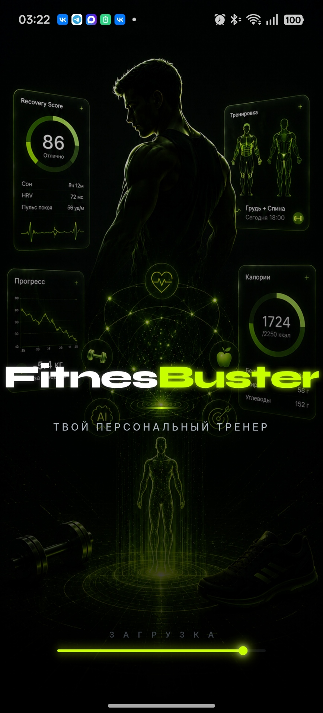
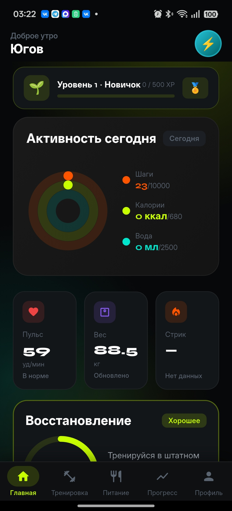
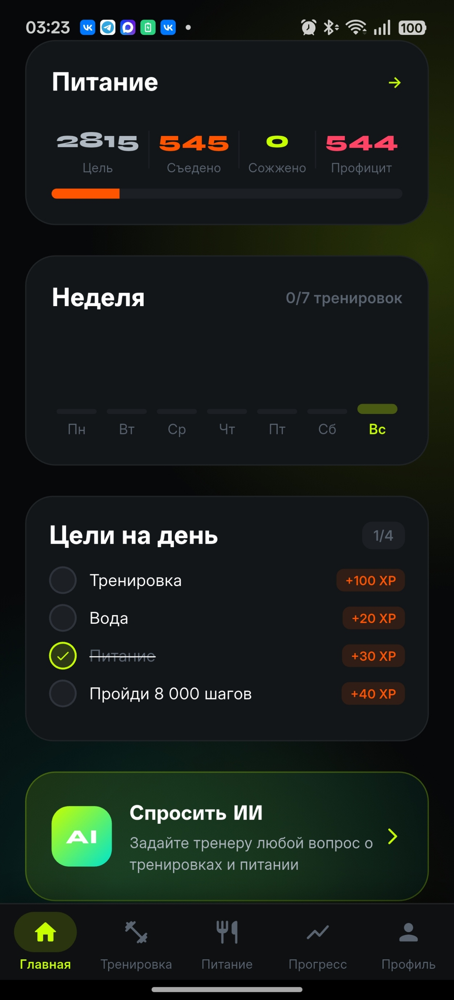
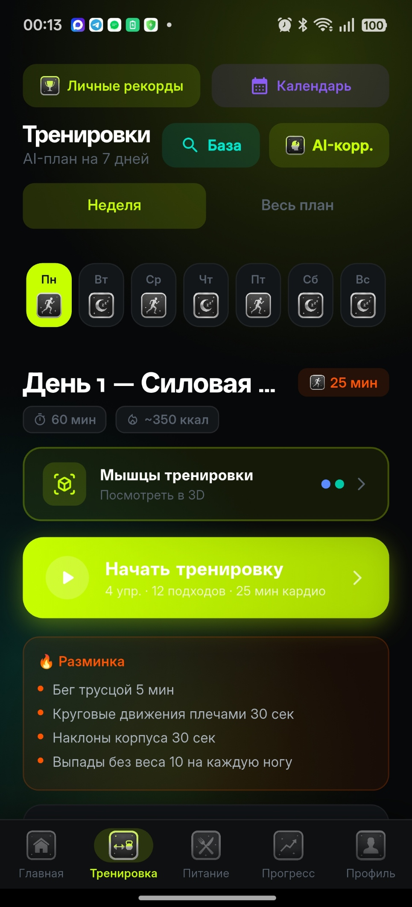
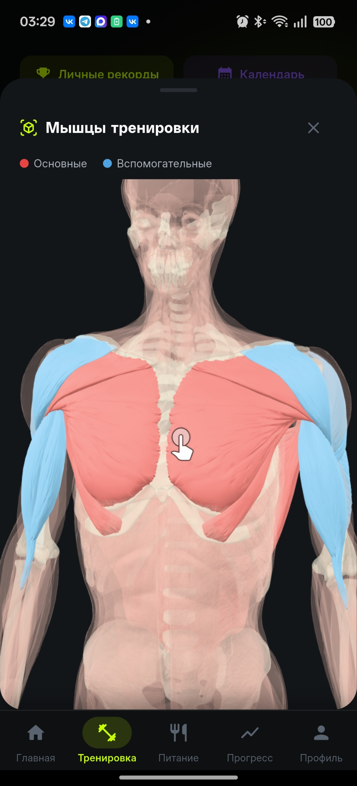
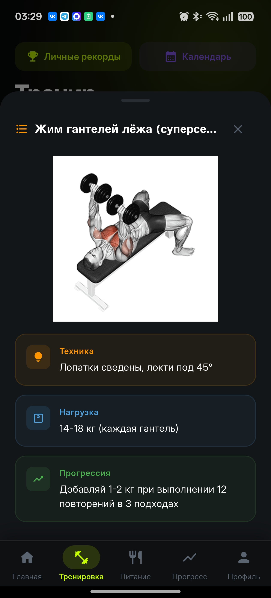
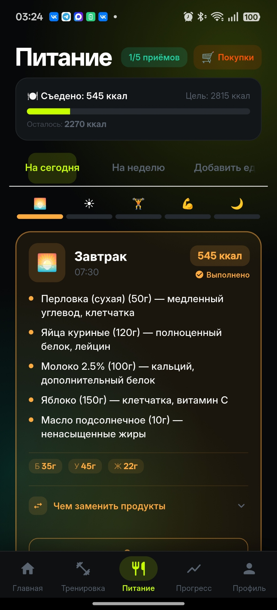
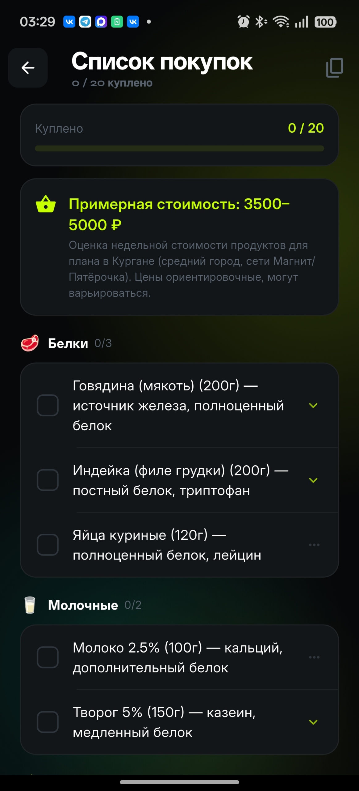
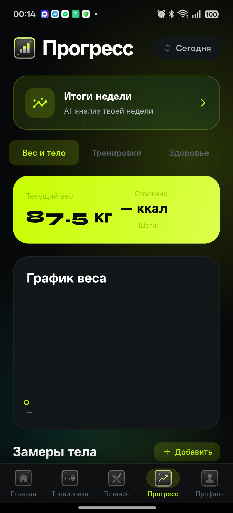
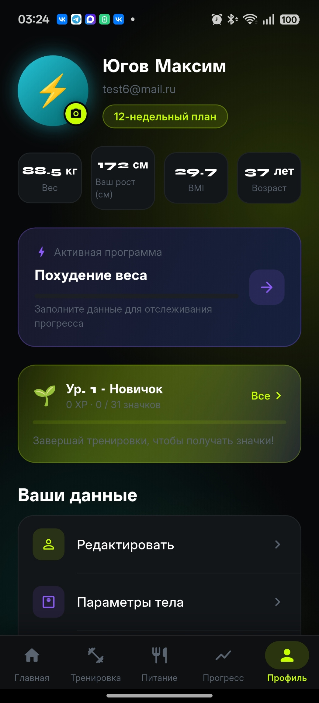

<p align="center">
  
</p>

<p align="center">
  <strong>Издатель:</strong> Югов Максим Александрович &nbsp;|&nbsp; <strong>Email:</strong> maksim.yugov.89@gmail.com
</p>

# FitnesBuster

[](https://github.com/maksimyugov89/fitnesbuster/actions/workflows/ci.yml)
[](https://github.com/maksimyugov89/fitnesbuster/actions/workflows/security.yml)

**Персональный AI-фитнес-тренер в кармане.**

FitnesBuster — Flutter-приложение (Android / iOS), которое генерирует персонализированные программы тренировок и питания на базе целей пользователя, уровня подготовки, доступного оборудования и медицинских ограничений. Используется **DeepSeek AI** для создания и корректировки планов, **Google Health Connect / Apple HealthKit** для синхронизации данных здоровья, **Firebase** (Firestore, Auth, Cloud Functions, FCM, Hosting) для бэкенда, **Hive** для офлайн-кэша, **OpenFoodFacts** для сканирования штрих-кодов. Интерактивная **3D анатомическая модель** на базе Z-Anatomy визуализирует задействованные мышцы с X-ray эффектом. База из **1 346 упражнений** с GIF-демонстрациями (100% покрытие) раздаётся через **Firebase Hosting CDN** с immutable-кэшированием.

Версия: `1.0.0+1` | `dart analyze` — 0 замечаний | **CI/CD**: 4 workflow на GitHub Actions | **Аудит безопасности + нагрузочное тестирование проведены** (02.07.2026)

| Метрика | Текущее состояние |
|---------|-------------------|
| Тестов | **319 проходят** (+13 skipped) + 2 golden отдельно (см. [Тестирование](#тестирование)) |
| Локализаций | **845+** ключей, 15 языков |
| `dart analyze` | **0 замечаний** (включая info-уровень) |
| CI/CD | **GitHub Actions**: analyze/format/test/coverage, сборка APK/AAB, подписанные релизы, сканирование уязвимостей |
| Экранов | 33/33 функциональны |

---

## Скриншоты

|||||
|---|---|---|---|

|||||
|---|---|---|---|

||||
|---|---|---|

---

## Конкурентные преимущества

| Преимущество | Описание | Конкуренты |
| --- | --- | --- |
| **3D анатомия с X-ray** | Z-Anatomy GLB, 239 региональных мешей, выделение первичных/вторичных мышц | Нет ни у одного из топ-10 |
| **Полная AI-экосистема** | Планы тренировок + питания + чат + дебриф + советы по технике — в одном приложении | Fitbod (только планы), BetterMe (только питание) |
| **Recovery Score** | Формула: сон (40%) + HRV (35%) + пульс покоя (25%) → адаптация нагрузки | Freeletics, Future (без авто-адаптации) |
| **Смарт-уведомления (ML)** | 21-дневный анализ паттернов → адаптивное время напоминания тренировки | Нет ни у одного из топ-10 |
| **6 кастомных тем** | 24 токена на тему, Neon Dark / Ocean Blue / Sunset Warm / Forest Green / Midnight Purple / CyberPunk | Нет ни у одного из топ-10 |
| **1 346 GIF + 15 языков** | Полный перевод базы упражнений на русский, CDN без API-ключей | Конкуренты не локализуют контент для RU-рынка |
| **WorkoutMiniPlayer** | Плавающий мини-плеер выполнения поверх всех экранов приложения | Нет ни у одного из топ-10 |
| **15 провайдеров здоровья** | Samsung Health, Garmin, Fitbit, Oura, Whoop, Polar и другие | Только Strava (но без AI и питания) |

---

## Быстрый старт

### Требования
- Flutter 3.27+ / Dart 3.6+
- Android 8.0+ (API 26) с установленным Google Health Connect
- iOS 14+ (Apple HealthKit)
- Firebase проект (Blaze plan) с Firestore, Authentication, Cloud Functions, FCM и Analytics
- DeepSeek API ключ
- Node.js 22+ и Firebase CLI (для деплоя Cloud Functions)

### Установка

```bash
git clone https://github.com/your-org/fitnesbuster.git
cd fitnesbuster
flutter pub get
flutter pub run build_runner build --delete-conflicting-outputs
```

Добавьте `google-services.json` (Android) в `android/app/` и `GoogleService-Info.plist` (iOS) в `ios/Runner/`.

```bash
# Деплой Firebase (правила, индексы, Cloud Functions)
cd functions && npm install && npm run build && cd ..
firebase login
firebase deploy

# Запуск приложения
flutter run --dart-define=DEEPSEEK_API_KEY=sk-xxxxxxxxxxxxxxxxxxxxxxxxx
```

---

## Архитектура

```
lib/
├── main.dart                       # Entry point, MultiBlocProvider, Hive init, NotificationService
├── bloc/                           # State management (BLoC)
│   ├── auth/                       # AuthBloc — email/Google вход, регистрация (AuthException в domain)
│   ├── user/                       # UserBloc — профиль, цели, параметры тела
│   ├── workout/                    # WorkoutBloc — выполнение тренировки (таймер, фазы, подходы)
│   ├── health/                     # HealthBloc, HealthSyncBloc — Health Connect / HealthKit
│   ├── nutrition/                  # NutritionBloc — дневной лог питания, AI-план (try-catch)
│   ├── ai/                         # AiBloc — генерация планов, AI-вопросы
│   ├── onboarding/                 # OnboardingBloc — 5-шаговый онбординг (+ OnboardingWorkflowService)
│   └── training/                   # TestWeekBloc — калибровочная неделя (TestWeekStateError + CompleteTestWeekUseCase)
├── core/                           # Сервисы и конфигурация
│   ├── ai/
│   │   ├── base_client.dart        # Общий HTTP-клиент с retry
│   │   ├── services/               # WorkoutPlanService, MealPlanService, PlanRefinementService,
│   │   │                           # ProgressAnalyzer, ChatService — 5 специализированных AI-сервисов
│   │   └── deepseek_service.dart   # Фасад (110 строк)
│   ├── analytics/                  # AnalyticsService — события login/signup/workout/onboarding/testweek
│   ├── constants/                  # SemanticColors (11 констант), AvatarPresets, AppConstants
│   ├── di/                         # GetIt DI — все сервисы по интерфейсам, 0 cast-выражений
│   ├── health/                     # HealthConnectService, HealthServiceAdapter (IHealthService)
│   ├── localization/               # AppLocalizations (845+ ключей, 15 языков), LanguageService
│   ├── notifications/              # NotificationService — локальные push + смарт-напоминание (DailyTime)
│   ├── router/                     # go_router (AppRouter) — навигация с ShellRoute, AuthRouterNotifier
│   ├── services/                   # WorkoutSession (DI), GamificationService, NutritionService,
│   │                               # FcmService, RecoveryScoreService, OnboardingWorkflowService,
│   │                               # TestWeekWorkflowService, MuscleZoneMatcher
│   └── theme/                      # ThemeService + ThemePalette (6 динамических тем)
├── data/                           # Репозитории и модели
│   ├── models/                     # ChatMessageModel, ExerciseDbModel (data-слой)
│   └── repositories/               # AuthRepository, UserRepository (Firestore + Hive), PrRepository,
│                                   # SettingsRepository
├── domain/                         # Доменный слой (чистый, без зависимостей на data/framework)
│   ├── entities/                   # 24 @freezed класса: UserProfile, WorkoutPlan, BodyMeasurement,
│   │                               # PersonalRecord, NutritionEntities, HealthEntities, DailyTime и др.
│   │                               # + 18 автогенерированных файлов (.freezed.dart + .g.dart)
│   ├── exceptions/                 # AuthException
│   ├── repositories/               # IAuthRepository, IUserRepository, IPrRepository, ISettingsRepository
│   ├── services/                   # 10 интерфейсов: IDeepSeekService, IGamificationService,
│   │                               # IHealthConnectService, IAdaptiveTrainingService, INutritionService,
│   │                               # IAnalyticsService, INotificationService, IFcmService,
│   │                               # IExerciseService, IHealthAnalyticsService
│   └── usecases/                   # CompleteTestWeekUseCase
└── presentation/
    ├── screens/                    # 33 экрана (все <700 строк)
    └── widgets/                    # 65+ переиспользуемых виджетов по доменам:
        ├── dashboard/              # DashboardAppBar, ActivityRingsCard, TodaysWorkoutCard, XpBar,
        │                           # NutritionSummaryCard, QuickStatsCard, AiChatCard, SocialCard
        ├── workout/                # WorkoutPlanHeader, WorkoutExerciseCard, WorkoutDaySelector,
        │                           # DayDetailView, WeeklySummaryCard, TechniqueSheet,
        │                           # MuscleMapWidget, ExerciseGifThumb, WorkoutPlanWidgets
        ├── nutrition/              # MealCard, DailyProgressCard, NutritionHeader, WeeklyPlanView,
        │                           # BarcodeScanCard, MealProgressBar, AddedFoodTile, WaterTrackerCard,
        │                           # FoodItemRow, ManualFoodForm, MacroRing, MealAlternativesTile
        ├── progress/               # ProgressPeriodSelector, ProgressStatsPanel, ProgressWorkoutLog,
        │                           # ProgressPhotoSection, ProgressAiAnalysisSection, ProgressWeightSection,
        │                           # ProgressHealthList, ProgressMeasurementCard, BodyMeasurementsDialog
        ├── profile/                # ProfileSheetWidgets, ProfileEditSheets, ProfileEditor,
        │                           # ProfileMiscWidgets, AvatarPickerSheet, LanguageSelectionSheet,
        │                           # ThemeSelectionSheet
        └── router/                 # MainShell, RouterWorkoutMiniPlayer, RouterBottomNav
```

**Паттерны:** Clean Architecture + BLoC + Repository

**DI:** GetIt — все сервисы и репозитории регистрируются по доменным интерфейсам (`IXxx`). Конкретные типы дополнительно регистрируются через ту же переменную-экземпляр — 0 cast-выражений (`as ConcreteType`). Все 35+ `sl<Concrete>()` заменены на `sl<IInterface>()`.

**Логирование:** `appLogger` (пакет `logger`) — 0 вызовов `print()` / `debugPrint()` / `kDebugMode`-гейтов.

**Офлайн-очередь:** `OfflineQueue` (Hive) + `connectivity_plus` listener + DI — операции буферизируются при отсутствии сети.

**Data → Domain:** `BodyMeasurement`, `PersonalRecord`, `TestDayExercise`, `ExerciseInfo` — в `domain/entities/`. `ChatMessageModel` — в data-слое, domain `ChatMessage` — чистая сущность без сериализации.

**Строгий линтер:** 8 правил (`prefer_const_constructors`, `avoid_print` и др.); `dart analyze --no-fatal-infos --no-fatal-warnings` → «No issues found!» (0 замечаний любого уровня, проверено в реальном CI)

**Навигация:** go_router с ShellRoute (bottom navigation) + WorkoutMiniPlayer поверх всех табов. Виджеты навигации (`MainShell`, `RouterBottomNav`, `RouterWorkoutMiniPlayer`) вынесены в `widgets/router/` и используют локализацию через `AppLocalizations.tl()`.

**DeepSeekService:** фасад (110 строк), делегирует 5 специализированным AI-сервисам + BaseClient. Смена AI-провайдера — одна реализация `IDeepSeekService`, без изменений в BLoC и UI. Cloud Functions организованы по доменам: `friends.ts`, `challenges.ts`, `feed.ts`, `proxies.ts`, `account.ts`, `maintenance.ts`, `shared.ts`.

---

## BLoC — полный перечень

| BLoC | Назначение | Ключевые события |
|---|---|---|
| **AuthBloc** | Email/Google вход, регистрация, проверка сессии, email-верификация | `AuthLoginRequested`, `AuthRegisterRequested`, `AuthGoogleLoginRequested`, `AuthLogoutRequested`, `AuthEmailVerificationChecked` |
| **UserBloc** | CRUD профиля, онбординг, настройки | `UserLoadRequested`, `UserUpdateProfile`, `UserUpdateBodyParams`, `UserUpdateGoal`, `UserUpdateSettings` |
| **WorkoutBloc** | Выполнение тренировки (таймер, фазы, сеты) | `WorkoutStartRequested`, `WorkoutPauseRequested`, `WorkoutResumeRequested`, `WorkoutStopRequested`, `WorkoutSetCompleted`, `WorkoutTick` |
| **HealthBloc** | Чтение данных из Health Connect | `HealthFetchRequested`, `HealthWatchRequested` |
| **HealthSyncBloc** | Полная синхронизация Health Connect | `HealthSyncInitializeRequested`, `HealthSyncReadToday`, `HealthSyncReadDateRange` |
| **NutritionBloc** | Дневной лог питания, AI-план питания | `NutritionLoadRequested`, `NutritionAddFood`, `NutritionRemoveFood`, `NutritionRegenerateMealPlan` |
| **AiBloc** | Генерация планов, AI-вопросы | `AiGenerateWorkoutPlan`, `AiGenerateMealPlan`, `AiAskQuestion`, `AiReset` |
| **OnboardingBloc** | 5-шаговый онбординг → генерация AI-планов | `OnboardingSetGoal`, `OnboardingSetIntensity`, `OnboardingSetLocation`, `OnboardingSetProfile`, `OnboardingFinalize` |
| **TestWeekBloc** | Тестовая неделя → калибровка → адаптация плана | `TestWeekStartDay`, `TestWeekRecordExercise`, `TestWeekFinishDay`, `TestWeekComplete`, `TestWeekAdjustGoal` |

Все BLoC-зависимости инъецируются через доменные интерфейсы (`IUserRepository`, `IAuthRepository`, `IDeepSeekService` и т.д.), без прямых ссылок на Firebase или конкретные реализации.

---

## Функциональность

### Аутентификация
| Функция | Описание |
|---|---|
| Вход | Email/пароль + Google Sign-In (`AuthBloc`, `AuthRepository`) |
| Регистрация | Email/пароль → `createUserWithEmailAndPassword` + документ в Firestore + автоотправка письма верификации (`sendEmailVerification()`) |
| Email-верификация | Доступ ко всему приложению (включая онбординг) заблокирован роутером, пока email не подтверждён. Экран `VerifyEmailScreen`: ручная проверка статуса, повторная отправка письма (cooldown 60с), автопроверка каждые 4с, выход из аккаунта. Google-аккаунты верифицируются автоматически и минуют экран |
| Сброс пароля | `sendPasswordResetEmail` |

### Онбординг и профиль
| Экран | Описание |
|---|---|
| Цель | Похудеть / набрать массу / форма / пляжный сезон / спортивные результаты |
| Интенсивность | Хардкор / интенсив / баланс / постепенный / лайт |
| Место тренировок | Тренажёрный зал / улица / дома + настройка бега |
| Профиль | Рост, вес, возраст, пол, уровень активности, медицинские ограничения |
| Health Connect | Запрос разрешений, первичная синхронизация (шаги, пульс, сон, вес) |

После онбординга DeepSeek AI генерирует персональный 7-дневный план тренировок с периодизацией и план питания.

### Тренировки
| Функция | Описание |
|---|---|
| 3D мышечная карта | Интерактивная 3D модель тела на базе Z-Anatomy (GLB, Draco-сжатие). При выборе мышцы или упражнения — X-ray эффект: нерелевантные мышцы становятся прозрачными (18% opacity), первичные подсвечиваются красным, вторичные синим. Парные мышцы подсвечиваются одновременно с обеих сторон. Тело покрыто 239 региональными мешами |
| AI-план | JSON-план от DeepSeek с периодизацией (Адаптация → Прогресс → Интенсификация → Пик), ротацией мышечных групп, RPE, темпом, подсказками по технике, схемами прогрессии |
| Rich-поля упражнений | Основная/вторичная мышца, guideline веса, RPE, темп, техника-подсказка, прогрессия |
| Тестовая неделя | 4 дня базовых упражнений для калибровки плана. AI анализирует реальные результаты и адаптирует веса/объём |
| AI-коррекция плана | 6 источников входных данных (Strava, Hevy, GPX, текст, файл, пост-тренировка), 3 режима: merge / preference / post_workout |
| GIF-демонстрации | 1 346 анимированных GIF (360p, ~276 КБ каждый) раздаются с Firebase Hosting CDN (`https://fitnesbuster.web.app/gifs/{id}.gif`). `Cache-Control: public, max-age=31536000, immutable`. Отображение через `CachedNetworkImage` |
| Видео-демо упражнений | Кнопка YouTube + AI советы по технике от DeepSeek с кэшем в SharedPreferences |
| Календарь тренировок | Месячный вид (table_calendar), перенос тренировок на другие дни |
| Выполнение | Система фаз (подготовка 15с / выполнение / отдых), TTS озвучка упражнений, счётчик подходов, WakeLock |
| WorkoutSession | Singleton, управляемый через DI (`sl<WorkoutSession>()`), — сессия живёт между экранами, таймер по wall-clock |
| WorkoutMiniPlayer | Плавающий мини-плеер поверх всех экранов с ShellRoute: фаза, упражнение, прогресс, обратный отсчёт |
| Сохранение | SharedPreferences: `workout_done_{date}`, `workout_kcal_{date}`, `workout_sets_{date}` |
| Персональные рекорды | PR трекер — упражнение, вес, повторения, подходы |

### Питание
| Функция | Описание |
|---|---|
| AI-план | Меню на день (завтрак, обед, ужин, перекусы) с макросами, добавками, советами по готовке |
| Расчёт макросов | `NutritionService.calculateMacros(UserProfile)` — автоматический расчёт нормы белков (30%), углеводов (40%), жиров (30%) по суточной цели калорий |
| Трекер воды | Кнопки +/– стакан (250 мл), персистентность по дате |
| Ручное добавление | Имя блюда + ккал, сохраняются в SharedPreferences |
| Штрих-код | Сканирование через `mobile_scanner` + OpenFoodFacts API — питательная ценность продукта |
| Список покупок | Автоматическое извлечение ингредиентов из AI-плана питания, категоризация по 7 группам, чекбоксы с персистентностью, AI-замена ингредиента (долгое нажатие), копирование, прогресс-бар |
| Калории | Визуальный прогресс-бар съедено/цель с макросами |

### Прогресс
| Функция | Описание |
|---|---|
| Статистика по периодам | Сегодня / Неделя / Месяц / Год с баровым графиком |
| Вес | График (из Health Connect или профиля) |
| Замеры тела | Грудь, талия, бёдра, % жира с дельтами. Сохраняются в Firestore. Модель `BodyMeasurement` — в `domain/entities/` |
| Фото | 3 ракурса (спереди, сбоку, сзади) с инструкциями по позированию |
| AI-анализ | DeepSeek анализирует динамику замеров и даёт рекомендации |
| AI-дебриф | Еженедельный отчёт: оценка 1-10, adherence, сводка тренировок и питания |
| Серия | Streak — количество последовательных дней с тренировкой |
| PR трекер | Отслеживание персональных рекордов (`PersonalRecord` — в `domain/entities/`) |

### Дашборд
| Функция | Описание |
|---|---|
| Приветствие | Имя пользователя + аватар (preset/фото) + время суток |
| XP-бар | Текущий уровень, название, прогресс до следующего уровня, кнопка к достижениям |
| Ежедневные задания | 4 авто-задания (тренировка / вода / питание / шаги) с XP-наградами |
| Кольца активности | Шаги, ккал, вода (из Health Connect + SharedPreferences) |
| Recovery Score | Индекс восстановления (0–100) на базе сна (×40%), HRV (×35%), пульса покоя (×25%) |
| Карточка питания | Съедено / Цель / Сожжено (BMR + активность) / Дефицит с прогресс-баром |
| Недельный график | Реальные данные о выполненных тренировках за 7 дней |
| Социальная карточка | Быстрый доступ к Ленте / Друзьям (badge с кол-вом запросов) / Челленджам |

### Гейм-фикация
| Функция | Описание |
|---|---|
| XP-система | Опыт начисляется за тренировки (+100), воду (+20), питание (+30), шаги (+40), достижения |
| 9 уровней | Новичок → Любитель → Атлет → Профи → Ветеран → Мастер → Элита → Легенда → Чемпион (названия локализованы через `tl()`) |
| 30 достижений | 6 категорий: серия дней, тренировки, вода, шаги, питание, XP-вехи |
| AchievementsScreen | Сетка достижений с анимацией разблокировки, прогресс-барами |

### Восстановление и адаптация
| Функция | Описание |
|---|---|
| Recovery Score | Автоматический подсчёт ночного восстановления по данным Health Connect (`RecoveryScoreService`) |
| HealthAnalyticsService | Агрегирует данные Health Connect: `sumSleepMinutes`, `sumValue`, `avgValue`, `lastValue` |
| Адаптация нагрузки | При низком восстановлении (<50) — баннер с рекомендацией снижения интенсивности на 15–20% |
| TDEE авторасчёт | При изменении веса через Health Connect автоматически пересчитывается дневная цель калорий (Mifflin-St Jeor) |
| Смарт-уведомления | Напоминание о тренировке адаптируется к реальному паттерну активности (анализ 21 дня) |

### Социальные функции
| Функция | Описание |
|---|---|
| Друзья | Поиск по username, отправка/принятие/отклонение запросов, удаление |
| Лента активности | Персонализированная лента событий друзей: тренировки, PR, достижения, челленджи |
| Челленджи | Создание публичных/приватных челленджей (тренировки / шаги / серия / калории), таблица лидеров |
| FCM-уведомления | Push при получении запроса в друзья, принятии, победе в челлендже |

---

## Firebase Cloud Functions (europe-west1, Node.js 22)

| Функция | Тип | Безопасность | Назначение |
|---|---|---|---|
| `sendFriendRequest` | Callable | Валидация toUid, rate limit 10/мин | Создаёт запрос, отправляет FCM + in-app уведомление |
| `acceptFriendRequest` | Callable | Транзакция Firestore, rate limit 20/мин | Принимает запрос, добавляет в friends обоих пользователей |
| `declineFriendRequest` | Callable | Rate limit 20/мин | Отклоняет запрос |
| `removeFriend` | Callable | Rate limit 20/мин | Удаляет из friends обоих направлений |
| `searchUsers` | Callable | Проверка типа query, .limit(500), rate limit 30/мин | Поиск по usernameLower с prefix-match, возвращает isFriend |
| `fanoutActivityEvent` | Firestore trigger | Best-effort чанки, .limit(500), retry | При записи в `activity_events/{uid}/items` — фанаут в feeds друзей |
| `createChallenge` | Callable | Лимиты title/duration/target, rate limit 5/мин | Создаёт челлендж + начальный progress-документ |
| `joinChallenge` | Callable | Rate limit 30/мин | Добавляет uid в participants, создаёт progress-документ |
| `updateChallengeProgress` | Callable | Монотонный clamp 0–1M, rate limit 30/мин | Обновляет прогресс, FCM при достижении цели, публикует feed-событие |
| `cleanOldFeedEvents` | Scheduled (03:00) | — | Удаляет события ленты старше 30 дней |
| `recordWorkout` | Callable | Транзакция Firestore, rate limit 30/мин | Запись завершённой тренировки в Firestore |
| `deepseekProxy` | Callable | Rate limit 20/мин, cap maxTokens ≤8192, ≤40 сообщений ≤20K симв. | Прокси для DeepSeek API — ключ в Secret Manager |
| `seedChallenges` | Callable | Admin-only (`token.role === 'admin'`) | Инициализация дефолтных публичных челленджей |
| `deleteAccount` | Callable | Только self (`request.auth.uid`) | GDPR-удаление: каскадно чистит Firestore (профиль, друзья, заявки, лента, участие в челленджах) + Firebase Auth |

**Инфраструктура:** `withRetry(fn, 3)` в `shared.ts`, JSDoc на всех экспортируемых функциях, `checkRateLimit()` — атомарный (Firestore-транзакция) sliding-window лимитер, применён ко всем callable-функциям кроме `deleteAccount` и `seedChallenges`, composite indexes в `firestore.indexes.json`.

---

## AI-помощник

| Функция | Описание |
|---|---|
| AI-чат | Полноэкранный multi-turn чат с DeepSeek AI. Контекст: профиль пользователя, история диалога |
| Кэш чата | Hive — до 50 сообщений, восстановление при перезапуске |
| Быстрые вопросы | «Как часто тренироваться?», «Что есть после тренировки?» и др. |
| Контекстная осведомлённость | Профиль (BMR/TDEE/BMI), последние темы обсуждения |

### Профиль

| Функция | Описание |
|---|---|
| Аватар | 10 emoji-градиентов или своё фото (камера / галерея) |
| Темы | 6 динамических тем с 24 цветовыми токенами каждая |
| Язык | 15 языков (переключение UI с флагами и нативными названиями) |
| Health Connect | Синхронизация: шаги, пульс, сон, вес, вода, тренировки — 15 провайдеров |
| Достижения | Превью уровня, XP-прогресс, разблокированные значки |
| Уведомления | Смарт-напоминание о тренировке + 6 напоминаний пить воду (9:00–19:00) |
| Удаление аккаунта | GDPR-совместимое — Cloud Function `deleteAccount` каскадно удаляет профиль, друзей, заявки, ленту, участие в челленджах и Firebase Auth запись; локально очищаются Hive-кэш и SharedPreferences |

---

## Система тем (ThemePalette)

24 цветовых токена на тему: primary, primaryDark, primaryLight, accent, accentOrange, accentPurple, background, surface, surfaceLight, surfaceCard, elevated, textPrimary, textSecondary, textMuted, textOnPrimary, success, warning, error, info, primaryGradient (3-stop), accentGradient (2-stop), glowPrimary (radial), scaffoldBg, cardBg.

| # | Тема | Primary | Концепция |
|---|---|---|---|
| 1 | **Neon Dark** (Electric Volt) | `#C8FF00` | Nike Training Club × Apple Fitness+ — чёрный + кислотный лайм |
| 2 | **Ocean Blue** (Deep Horizon) | `#00CFFF` | Биолюминесцентный глубокий океан — ультра-тёмный navy + циан |
| 3 | **Sunset Warm** (Aurora Flame) | `#FF4D1A` | Северное огненное сияние — тёмно-бордовый + коралл + золотой |
| 4 | **Forest Green** (Jade Matrix) | `#00D46A` | Биолюминесцентные джунгли — почти чёрный + изумруд + мята |
| 5 | **Midnight Purple** (Nebula) | `#A855F7` | Космическая пустота + aurora borealis — пурпур + фиолет + роза |
| 6 | **CyberPunk** (Neon Tokyo) | `#00F5FF` | Максимальный киберпанк-контраст — абсолютный чёрный + циан + маджента |

Типографика: **Syne** (display, 56px–20px) + **Inter** (body, 16px–12px). 11 предопределённых стилей текста.

---

## Поддерживаемые языки (15)

| # | Язык | Код | Флаг |
|---|---|---|---|
| 1 | Русский | `ru` | 🇷🇺 |
| 2 | English | `en` | 🇬🇧 |
| 3 | Español | `es` | 🇪🇸 |
| 4 | Deutsch | `de` | 🇩🇪 |
| 5 | Français | `fr` | 🇫🇷 |
| 6 | Italiano | `it` | 🇮🇹 |
| 7 | Português | `pt` | 🇵🇹 |
| 8 | Türkçe | `tr` | 🇹🇷 |
| 9 | العربية | `ar` | 🇸🇦 |
| 10 | 中文 | `zh` | 🇨🇳 |
| 11 | 日本語 | `ja` | 🇯🇵 |
| 12 | 한국어 | `ko` | 🇰🇷 |
| 13 | हिन्दी | `hi` | 🇮🇳 |
| 14 | Українська | `uk` | 🇺🇦 |
| 15 | Беларуская | `be` | 🇧🇾 |

По умолчанию: Русский (`ru`). Локализация охватывает 845+ ключей через `AppLocalizations.tl()` / `tlp()`. Все BLoC-сообщения, роутер, сервисы и виджеты используют `tl()`. 0 хардкодированных UI-строк. Фоллбэк на английский при отсутствии перевода.

---

## Health Connect — поддерживаемые провайдеры (15)

| Провайдер | Тип подключения |
|---|---|
| Samsung Health ⌚ | Нативная запись в Health Connect |
| Google Fit / Health Connect 🔄 | Нативная запись в Health Connect |
| Health Connect (Android) 📊 | Прямой доступ |
| Garmin Connect 🏋️ | Требуется bridge (Health Sync) |
| Fitbit 💙 | Требуется bridge |
| Huawei Health 📱 | Требуется bridge |
| Zepp Life 🔵 | Требуется bridge |
| Mi Fitness ⚪ | Требуется bridge |
| Polar Flow 🔴 | Требуется bridge |
| Suunto ⏱️ | Требуется bridge |
| Coros 🟢 | Требуется bridge |
| Whoop 🟡 | Требуется bridge |
| Oura 💍 | Требуется bridge |
| Withings Health Mate ⚖️ | Требуется bridge |
| Apple Health 🍎 | HealthKit (iOS) |

Данные синхронизируются: шаги, активные ккал, общие ккал, пульс, пульс покоя, HRV, частота дыхания, вес, рост, дистанция, сон, вода, тренировки. Дедупликация шагов через `getTotalStepsInInterval`.

---

## Технологический стек

### Core
| Технология | Версия | Назначение |
|---|---|---|
| Flutter | 3.27+ | Кроссплатформенный UI (Android, iOS) |
| Dart | 3.10.3+ | Язык |
| flutter_bloc | ^9.1.1 | State management |
| go_router | ^17.3.0 | Навигация с ShellRoute |
| get_it | ^9.2.1 | Dependency Injection |
| equatable | ^2.0.5 | Сравнение состояний BLoC |
| freezed / freezed_annotation | — | Иммутабельные модели данных (24 класса, 18 автогенерированных файлов) |

### Хранение данных
| Технология | Назначение |
|---|---|
| Firebase Firestore | Профили, AI-планы, замеры, друзья, лента, челленджи, уведомления |
| Firebase Auth | Email/пароль + Google Sign-In + email-верификация |
| Firebase Analytics | Аналитика: экраны, тренировки, питание, онбординг |
| Firebase Cloud Functions | Бэкенд-логика: друзья, лента, челленджи, FCM, scheduled jobs |
| Firebase Messaging (FCM) | Push-уведомления: запросы в друзья, принятие, победа в челлендже |
| SharedPreferences | Ежедневный трекинг, кэш советов по упражнениям, список покупок, перенос тренировок |
| Hive | Офлайн-кэш AI-планов, истории чата, дебрифов; очередь отложенной синхронизации. Шифруется `HiveAesCipher`, ключ — в `flutter_secure_storage` |

### AI и API
| Сервис | Назначение |
|---|---|
| DeepSeek API | Генерация планов тренировок и питания, анализ прогресса, AI-чат, дебриф, советы по технике, AI-коррекция плана, замена ингредиентов |
| Google Health Connect | Шаги, ккал, пульс, сон, вес, тренировки (Android) |
| Apple HealthKit | Аналогично (iOS) |
| OpenFoodFacts | Питательная ценность по штрих-коду |
| YouTube Search | Видео-демо упражнений (url_launcher → поиск по названию) |

### UI и анимации
| Пакет | Назначение |
|---|---|
| model_viewer_plus | 3D GLB viewer (WebView + localhost proxy) — анатомическая модель |
| syncfusion_flutter_charts | Продвинутые графики |
| shimmer | Placeholder загрузки |
| table_calendar | Календарь тренировок |
| cached_network_image | Кэширование изображений и GIF |

### Устройства и сенсоры
| Пакет | Назначение |
|---|---|
| health | Health Connect / HealthKit |
| permission_handler | Запрос разрешений |
| wakelock_plus | Экран не гаснет во время тренировки |
| flutter_tts | TTS — произносит упражнения голосом |
| mobile_scanner | Сканер штрих-кодов |
| image_picker | Камера / галерея для фото и аватаров |
| file_picker | Открытие файлов (GPX, JSON, TXT) для AI-коррекции плана |
| url_launcher | Открытие YouTube и внешних ссылок |

### Firebase (backend)
| Пакет | Версия | Назначение |
|---|---|---|
| firebase_core | ^4.10.0 | Инициализация Firebase |
| firebase_auth | ^6.5.2 | Аутентификация |
| cloud_firestore | ^6.5.0 | База данных |
| cloud_functions | ^6.0.2 | Вызов Cloud Functions |
| firebase_messaging | ^16.0.0 | FCM push-уведомления |
| firebase_analytics | ^12.4.2 | Аналитика |

### Утилиты
| Пакет | Назначение |
|---|---|
| flutter_local_notifications | Локальные push-уведомления |
| timezone | Часовые пояса для планировщика уведомлений |
| connectivity_plus | Мониторинг соединения |
| http | HTTP-клиент для DeepSeek API |
| intl | Интернационализация |
| uuid | Генерация уникальных ID |
| logger | Структурированное логирование (`appLogger`) |
| freezed / freezed_annotation | Иммутабельные модели данных |
| json_annotation / json_serializable | JSON-сериализация |
| flutter_secure_storage | Keychain (iOS) / EncryptedSharedPreferences (Android) — хранит ключ шифрования Hive |

---

## SharedPreferences — ключи

Формат даты: `{year}_{month}_{day}` (например `2026_6_15`)

```
workout_done_{date}              bool    — тренировка выполнена
workout_kcal_{date}              int     — ккал сожжено на тренировке
workout_sets_{date}              int     — количество подходов
water_glasses_{date}             int     — стаканы воды
water_ml_{date}                  int     — вода в мл (glasses × 250)
eaten_cal_{date}                 int     — потреблено ккал
target_cal_{date}                int     — целевые ккал на день
manual_steps_{date}              int     — шаги введённые вручную
manual_heartrate_{date}          int     — пульс введённый вручную
workout_time_{date}              int     — время тренировки (для смарт-уведомлений)
avatar_mode                      String  — "preset" | "custom" | "initials"
avatar_preset_index              int     — 0–9
avatar_custom_path               String  — путь к фото аватара
app_theme                        int     — индекс темы (0–5)
app_language                     String  — код языка ("ru", "en", ...)
shopping_list_checked            String  — JSON Map<String, bool> — отмеченные ингредиенты
workout_calendar_overrides       String  — JSON Map<"yyyy-MM-dd", int> — переносы тренировок
exercise_tips_{exerciseId}       String  — кэш AI-советов по технике упражнения
social_username                  String  — username пользователя для социальных функций
```

## Hive — ключи кэша

```
ai_workout_{uid}            String  — JSON AI-плана тренировок
ai_meal_{uid}               String  — JSON AI-плана питания
ai_ts_{uid}                 String  — ISO timestamp последней генерации
test_week_{uid}             String  — флаг завершения тестовой недели
chat_{uid}                  String  — JSON истории AI-чата (до 50 сообщений)
debrief_{uid}               String  — JSON последнего еженедельного дебрифа
needs_sync_{uid}            String  — флаг "true" — требуется синхронизация с Firestore
```

---

## Firebase Firestore — структура

```
users/{uid}                                 — единый документ, без подколлекций для профиля
  ├── name, email, avatarUrl, createdAt
  ├── fcmToken                              — FCM-токен для push-уведомлений
  ├── username, usernameLower               — для поиска в социальных функциях
  ├── onboarding: { goal, intensity, location, runningPreference }
  ├── profile: { weight, height, age, gender, activityLevel, medicalRestrictions, ... }
  ├── aiPlans: { workoutPlan, mealPlan, generatedAt }
  └── bodyMeasurements: [ { date, chestCm, waistCm, hipsCm, bodyFatPercent }, ... ]  — arrayUnion

friend_requests/{reqId}
  └── { fromUid, fromName, toUid, status, createdAt }  — status: pending|accepted|declined

friends/{uid}/list/{friendUid}
  └── { name, addedAt }

activity_events/{uid}/items/{eventId}
  └── { type, data, timestamp }

feed/{uid}/events/{eventId}
  └── { type, fromUid, fromName, data, timestamp }

challenges/{challengeId}
  └── { title, description, goalType, targetValue, durationDays, isPublic,
        createdBy, creatorName, participants[], startDate, endDate }

challenge_progress/{challengeId}/participants/{uid}
  └── { name, currentValue, updatedAt }

notifications/{uid}/items/{notifId}
  └── { type, title, body, data, createdAt, read }
```

Имена коллекций вынесены в `FirestoreCollections` — строковые константы, нет хардкода `.collection('users')` в коде.

### Firebase Hosting (GIF CDN)

```
https://fitnesbuster.web.app/gifs/{exerciseDbId}.gif
```

- **1 346 GIF-файлов** (360p, суммарно ~376 МБ)
- Заголовки: `Cache-Control: public, max-age=31536000, immutable`
- Публичный доступ: без авторизации, без API-ключей

### Firestore Security Rules

После аудита безопасности (02.07.2026) все коллекции, которые фактически мутируются только через Cloud Functions, закрыты от прямой клиентской записи — раньше правила разрешали её, что позволяло любому авторизованному клиенту (не обязательно через приложение) обходить валидацию Cloud Function прямым запросом к Firestore.

- `users/{uid}`: чтение и запись — только владелец (раньше читать мог любой авторизованный — утечка email/медограничений чужих пользователей)
- `friend_requests/{reqId}`: чтение — участники; запись — только Admin SDK
- `friends/{uid}/list/*`: чтение — владелец; запись — только Admin SDK
- `activity_events/{uid}/*`: чтение — владелец; запись — только Admin SDK (публикация клиентом сейчас не используется)
- `feed/{uid}/*`: чтение — владелец; запись — только Admin SDK
- `challenges/*`: чтение — любой авторизованный; запись — только Admin SDK (лимиты title/duration/target проверяются в `createChallenge`)
- `challenge_progress/*`: чтение — любой авторизованный; запись — только Admin SDK (раньше участник мог напрямую выставить себе любой `currentValue` — чит в лидерборде)
- `notifications/{uid}/*`: чтение — владелец; запись — только Admin SDK (коллекция пока не используется клиентом)

---

## Навигация (go_router)

```
/                               → SplashScreen
/login                          → LoginScreen
/register                       → RegisterScreen
/verify-email                   → VerifyEmailScreen
/onboarding                     → OnboardingScreen
  /goal                         → GoalSelectionScreen
  /intensity                    → IntensitySelectionScreen
  /location                     → WorkoutLocationScreen
  /profile                      → ProfileSetupScreen

[ShellRoute — нижняя навигация + WorkoutMiniPlayer]
/dashboard                      → DashboardScreen
/workout                        → WorkoutPlanScreen
/nutrition                      → NutritionScreen
/progress                       → ProgressScreen
/profile                        → ProfileScreen

/workout/session/:id            → WorkoutSessionScreen
/workout/log/:id                → WorkoutLogScreen
/workout/calendar               → WorkoutCalendarScreen
/workout/execution              → WorkoutExecutionScreen
/test-week                      → TestWeekScreen
/nutrition/diary                → FoodDiaryScreen
/nutrition/meal-plan            → MealPlanScreen
/shopping-list                  → ShoppingListScreen
/health-sync                    → HealthSyncScreen
/pr                             → PrScreen
/exercises                      → ExerciseBrowserScreen
/exercises/:id                  → ExerciseDetailScreen
/chat                           → AiChatScreen
/debrief                        → WeeklyDebriefScreen
/achievements                   → AchievementsScreen
/social/feed                    → FeedScreen
/social/friends                 → FriendsScreen
/social/challenges              → ChallengesScreen
```

---

## Статус разработки

| Экран | Готовность | Примечание |
|---|---|---|
| SplashScreen | ✅ Готов | Auth check + redirect |
| LoginScreen | ✅ Готов | Email/пароль + Google Sign-In |
| RegisterScreen | ✅ Готов | Email + Firestore doc + автоотправка письма верификации |
| VerifyEmailScreen | ✅ Готов | Блокирует доступ до подтверждения email, повторная отправка, автопроверка |
| Онбординг (5 шагов) | ✅ Готов | Goal → AI генерация планов |
| DashboardScreen | ✅ Готов | HC + XP-бар + Recovery Score + социальная карточка |
| WorkoutPlanScreen | ✅ Готов | AI-план с периодизацией + AI-коррекция + календарь |
| WorkoutCalendarScreen | ✅ Готов | Перенос тренировок, список ближайших |
| WorkoutExecutionScreen | ✅ Готов | Таймер, TTS, WakeLock, фазы, WorkoutMiniPlayer |
| WorkoutSessionScreen | ✅ Готов | Загружает реальный план через UserRepository |
| WorkoutLogScreen | ✅ Готов | Лог тренировки |
| ExerciseDetailScreen | ✅ Готов | GIF-демо + YouTube видео + AI советы по технике |
| ExerciseBrowserScreen | ✅ Готов | Каталог упражнений |
| TestWeekScreen | ✅ Готов | 4 дня → AI калибровка → адаптация плана |
| NutritionScreen | ✅ Готов | Трекер воды + питания |
| ShoppingListScreen | ✅ Готов | Категоризация, чекбоксы, AI-замена ингредиента |
| FoodDiaryScreen | ✅ Готов | Дневник питания |
| MealPlanScreen | ✅ Готов | AI-план питания |
| BarcodeScannerScreen | ✅ Готов | mobile_scanner + OpenFoodFacts |
| ProgressScreen | ✅ Готов | Периоды, графики, фото, замеры, AI-анализ |
| WeeklyDebriefScreen | ✅ Готов | AI-дебриф: оценка, adherence, улучшения |
| ProfileScreen | ✅ Готов | Аватар, темы, языки, HC-синхронизация, достижения |
| AchievementsScreen | ✅ Готов | XP, уровни, 30 достижений |
| HealthSyncScreen | ✅ Готов | Health Connect, 15 провайдеров |
| AiChatScreen | ✅ Готов | Multi-turn AI-чат, Hive-кэш, контекст профиля |
| PrScreen | ✅ Готов | Трекер персональных рекордов |
| FeedScreen | ✅ Готов | Лента активности друзей |
| FriendsScreen | ✅ Готов | Друзья / Запросы / Поиск (3 вкладки) |
| ChallengesScreen | ✅ Готов | Мои / Публичные, создать, таблица лидеров |

**Общая готовность: 100%** (33/33 экрана функциональны)

---

## Тестирование

```bash
flutter test
```

**319 unit/widget/E2E тестов проходят** (+ 13 skipped — требуют реального устройства, Firebase или отсутствующего в тестовом окружении `BlocProvider`) в ~22 файлах, плюс 2 golden-теста отдельно (см. ниже):

| Файл | Покрытие |
|---|---|
| `test/bloc/auth_bloc_test.dart` | AuthBloc — login, register, google, logout |
| `test/bloc/user_bloc_test.dart` | UserBloc — load, update profile |
| `test/bloc/workout_bloc_test.dart` | WorkoutBloc — start, tick, complete |
| `test/bloc/nutrition_bloc_test.dart` | NutritionBloc — load, add/remove food |
| `test/bloc/ai_bloc_test.dart` | AiBloc — generate plan, ask question |
| `test/bloc/health_bloc_test.dart` | HealthBloc — fetch, watch |
| `test/bloc/health_sync_bloc_test.dart` | HealthSyncBloc — initialize, read |
| `test/bloc/onboarding_bloc_test.dart` | OnboardingBloc — 5 steps + finalize |
| `test/bloc/test_week_bloc_test.dart` | TestWeekBloc — start, record, complete |
| `test/data/auth_repository_test.dart` | AuthRepository — login/register flows |
| `test/data/user_repository_test.dart` | UserRepository — CRUD профиля |
| `test/data/settings_repository_test.dart` | SettingsRepository — safe getters/setters |
| `test/data/gamification_service_test.dart` | GamificationService — XP, уровни, достижения |
| `test/data/weekly_debrief_test.dart` | WeeklyDebrief — fromJson, defaults, round-trip |
| `test/domain/user_profile_test.dart` | UserProfile — BMR/TDEE, defaults() factory |
| `test/services/recovery_score_service_test.dart` | 17 тестов — уровни, shouldReduceIntensity, formatSleep |
| `test/services/adaptive_training_service_test.dart` | 12 тестов — calculateAdjustment, buildAdaptedPlan |
| `test/services/social_models_test.dart` | 9 тестов — FeedEvent, Challenge, ChallengeParticipant |
| `test/services/nutrition_service_test.dart` | NutritionService — calculateMacros |
| `test/services/deepseek_service_test.dart` | DeepSeekService — парсинг ответов |
| `test/services/onboarding_workflow_service_test.dart` | OnboardingWorkflowService — 3 теста |
| `test/widget_test.dart` | Smoke test |
| `test/integration/onboarding_e2e_test.dart` | **E2E** — 8 тестов (bloc_test + mockito) |
| `test/integration/workout_e2e_test.dart` | **E2E** — 8 тестов (bloc_test + mockito) |
| `test/golden/` | **Golden** — DashboardScreen + WorkoutPlanScreen (PNG сгенерированы) |

Mock-файлы генерируются через `mockito` + `build_runner`.

```bash
# Только E2E тесты
flutter test test/integration/

# Golden тесты (требуют display-сервер; ⚠️ виснут на 10 минут даже на
# ubuntu-latest CI, поэтому исключены из автопрогона — гоняйте только локально)
flutter test test/golden/
```

`ci.yml` и `release.yml` автоматически запускают все unit/widget/E2E тесты (без `test/golden/`) на каждый push/PR, с `dart analyze`, проверкой формата и отчётом о покрытии в комментарии PR — см. [docs/CI_CD.md](docs/CI_CD.md).

---

## 3D Анатомическая модель

### Стек

- **Источник**: Z-Anatomy (открытый Blender-проект, 2562 меша)
- **Формат**: GLB с Draco-сжатием (уровень 6), `assets/anatomy/muscles_3d.glb`
- **Рендеринг**: `model_viewer_plus` — обёртка над `<model-viewer>` web component через WebView
- **Прозрачность**: пост-обработка GLB (Python) — патчинг JSON-чанка бинарного GLB для установки `alphaMode: BLEND` и `doubleSided: true` на всех материалах

### Структура материалов

- **63 материала**: 31 группа мышц × 2 (стороны `_l` / `_r`) + `body_fill`
- Каждая сторона парной мышцы имеет **отдельный материал** (`latissimus_l`, `latissimus_r`)
- `body_fill` — 239 мешей из коллекции `7:Regions of human body` Z-Anatomy

### X-ray эффект (JavaScript в WebView)

```javascript
function isIn(matName, list) {
  for (var i = 0; i < list.length; i++) {
    var id = list[i];
    if (matName === id || matName === id + '_l' || matName === id + '_r') return true;
  }
  return false;
}
// Dart передаёт ['latissimus'] → JS матчит 'latissimus_l' и 'latissimus_r' одновременно
// Первичные мышцы: [0.91, 0.27, 0.24, 1.0]  — ярко-красный
// Вторичные:       [0.31, 0.64, 0.88, 1.0]  — ярко-синий
// Остальные:       [0.72, 0.45, 0.38, 0.18] — полупрозрачная плоть (X-ray)
// Нет подсветки:   [0.72, 0.45, 0.38, 1.0]  — нормальный тон кожи
```

---

## AI-архитектура (DeepSeek)

### Архитектура AI-слоя

`deepseek_service.dart` — **фасад (110 строк)**, делегирует вызовы 5 специализированным сервисам:

| Сервис | Файл | Назначение |
|---|---|---|
| `WorkoutPlanService` | `core/ai/services/` | Генерация + парсинг плана тренировок |
| `MealPlanService` | `core/ai/services/` | Генерация + парсинг плана питания |
| `PlanRefinementService` | `core/ai/services/` | Коррекция плана (6 источников, 3 режима) |
| `ProgressAnalyzer` | `core/ai/services/` | Анализ замеров + дебриф |
| `ChatService` | `core/ai/services/` | Multi-turn чат с историей |
| `BaseClient` | `core/ai/` | HTTP-клиент с retry, общий для всех сервисов |

### Возможности DeepSeekService (через `IDeepSeekService`)
1. **generateWorkoutPlan** — персональный недельный план с периодизацией
2. **generateMealPlan** — дневной план питания с макросами и добавками
3. **refineWorkoutPlan** — пост-тестовая калибровка на основе реальных данных
4. **correctWorkoutPlan** — AI-коррекция существующего плана (merge / preference / post_workout)
5. **parseWorkoutFromContent** — парсинг плана из произвольного текста/файла
6. **analyzeProgress** — анализ замеров тела с рекомендациями
7. **generateWeeklyDebrief** — еженедельный отчёт с оценкой и adherence
8. **askQuestion** — single-turn Q&A с контекстом профиля
9. **askWithHistory** — multi-turn чат с историей до 20 сообщений
10. **checkGoalFeasibility** — проверка реалистичности цели

### Параметры
- **Модель**: `deepseek-chat` (конфигурируется через `--dart-define=DEEPSEEK_MODEL`)
- **Temperature**: 0.7 | **Max tokens**: 8192 (планы), 2048 (чат) | **Top-p**: 0.9
- **Таймаут**: 60 секунд, 3 автоматических ретрая (кроме 401/429)
- **Ключ**: никогда не попадает в APK — только через `deepseekProxy` Cloud Function (Secret Manager)

---

## Платформы

| Платформа | Статус | Примечание |
|---|---|---|
| Android | ✅ Основная | API 26+, Health Connect, FCM, Google Sign-In |
| iOS | ✅ Поддержка | iOS 14+, HealthKit |

---

## Требования к окружению

- Google Health Connect установлен на устройстве (Android 8+)
- DeepSeek API ключ передаётся через `--dart-define=DEEPSEEK_API_KEY=sk-...`
- Файл `google-services.json` в `android/app/`
- Файл `GoogleService-Info.plist` в `ios/Runner/` (для iOS)
- Firebase проект **Blaze plan** с включёнными: Firestore, Authentication, Cloud Functions, FCM, Analytics
- SHA-1 / SHA-256 fingerprint добавлены в Firebase Console (для Google Sign-In)
- Node.js 22+ и Firebase CLI для деплоя Cloud Functions

---

## Дорожная карта

### ✅ Завершено (1 июля 2026) — CI/CD-инфраструктура

Полноценная инженерная инфраструктура коммерческого уровня, проверенная в реальной эксплуатации (не только настроена — прогнана на живом GitHub Actions, найденные баги исправлены).

| Задача | Статус | Описание |
| --- | --- | --- |
| GitHub Actions — 4 workflow | ✅ | `ci.yml` (analyze/format/test/coverage), `build.yml` (APK/AAB артефакты), `release.yml` (подписанный релиз + GitHub Release), `security.yml` (сканирование уязвимостей) |
| Release-подпись | ✅ | `android/app/build.gradle.kts` — release keystore из `key.properties` с fallback на debug-подпись; секреты через GitHub Secrets |
| Автоматические GitHub Release | ✅ | По git-тегу `v*.*.*` или вручную (`workflow_dispatch`), гейт качества (analyze+test), автосгенерированный changelog |
| Отчёты о покрытии | ✅ | Комментарий с покрытием в каждом PR (без стороннего сервиса — Codecov заблокирован в РФ) |
| Сканирование уязвимостей | ✅ | OSV-Scanner на `pubspec.lock` и `functions/package-lock.json`, уже поймал реальную CVE в `uuid` |
| Telegram-уведомления | ✅ | О падениях CI и о выпущенных релизах |
| Dependabot | ✅ | Автообновление зависимостей (pub/npm/github-actions), 10 PR уже смерджено |
| Исправлены реальные баги, найденные при первом прогоне | ✅ | Нерабочий branch-триггер (`main` вместо `master`), хардкод локального JDK-пути, неотформатированный код (275 файлов), OOM при сборке на CI-раннере (лишний `-Xmx8G`), зависающие golden-тесты, пустая `assets/animations/`, 10 сломанных тестов (устаревшие моки/ассершены) |
| `dart analyze` — 0 замечаний | ✅ | 61 `curly_braces_in_flow_control_structures` устранены через `dart fix --apply` |
| Документация | ✅ | [docs/CI_CD.md](docs/CI_CD.md) — секреты, релизы, покрытие, известные ограничения |

### ✅ Завершено (1 июля 2026) — Email-верификация при регистрации

| Задача | Статус | Описание |
| --- | --- | --- |
| Отправка письма верификации | ✅ | `AuthRepository.register()` вызывает `sendEmailVerification()` сразу после создания аккаунта; ошибка отправки не блокирует регистрацию |
| Гейт доступа в роутере | ✅ | `AppRouter._redirect` блокирует все маршруты (включая онбординг), пока `AuthStateAuthenticated.emailVerified == false`, и редиректит на `/verify-email` |
| VerifyEmailScreen | ✅ | Ручная проверка (`AuthEmailVerificationChecked` → `reloadAndCheckEmailVerified()`), повторная отправка письма с cooldown 60с, автопроверка каждые 4с, выход из аккаунта |
| Обратная совместимость | ✅ | Существующие неверифицированные пользователи тоже проходят гейт при следующем входе и могут запросить письмо повторно; Google-аккаунты считаются верифицированными автоматически |
| Локализация | ✅ | Новые ключи `verifyEmail*` добавлены в ru/en (остальные 13 языков — автофоллбэк на английский) |

### ✅ Завершено (2 июля 2026) — Аудит безопасности

Ручной аудит по 5 направлениям (Firestore rules, Cloud Functions, хранение данных, GDPR, зависимости). Полный список находок и приоритетов — в истории обсуждения; ключевые исправления:

| Находка | Серьёзность | Исправление |
| --- | --- | --- |
| «Удаление аккаунта» ничего не удаляло, только `context.go('/login')` | Критично | Новая Cloud Function `deleteAccount` — каскадно чистит Firestore (профиль, друзья, заявки, лента, уведомления, участие в челленджах) + Firebase Auth; клиент дополнительно чистит Hive/SharedPreferences |
| `challenge_progress` писался клиентом напрямую — чит лидерборда в обход `updateChallengeProgress` | Критично | Firestore rules: запись только через Admin SDK |
| `users/{uid}` читался любым авторизованным — утечка email/медограничений чужих профилей | Высокая | Rules: чтение только владельцем; проверено, что клиент нигде не читает чужие профили напрямую (поиск/друзья используют денормализованные поля) |
| `challenges` создавались/менялись клиентом в обход лимитов `createChallenge` | Высокая | Rules: запись только через Admin SDK |
| Соц. и challenge-функции без rate-limiting (спам, накрутка FCM/Firestore-costов) | Высокая | `checkRateLimit()` добавлен в 8 функций (`friends.ts`, `challenges.ts`) |
| `deepseekProxy` принимал неограниченные `messages`/`maxTokens` — риск накрутки счёта за платный API | Высокая | Кламп `maxTokens` ≤8192, ≤40 сообщений, ≤20K символов на сообщение |
| Hive-кэш (AI-планы, история чата) хранился на диске в открытом виде | Средняя | `HiveAesCipher` + ключ в `flutter_secure_storage` (Keychain/EncryptedSharedPreferences) |
| `checkRateLimit()` не был атомарен (read-then-write) — гонка позволяла обойти лимит | Средняя | Переведён на `db.runTransaction()` |
| `activity_events`/`notifications` разрешали прямую клиентскую запись без валидации | Средняя | Rules: запись только через Admin SDK (обе коллекции сейчас не пишутся клиентом) |
| `friend_requests` update разрешал менять любое поле, не только `status` | Средняя | Rules: запись только через Admin SDK |

### ✅ Завершено (2 июля 2026) — Нагрузочное тестирование Cloud Functions

Прогнан реальный нагрузочный тест против прод-функций (europe-west1): 20 тестовых пользователей через Identity Toolkit REST API (без admin-ключей), ~250 вызовов по соц./challenge-функциям и `deepseekProxy` (валидация — бесплатно, ~30 коротких реальных AI-вызовов — на пару центов), все тестовые пользователи и данные удалены после теста через `deleteAccount`.

| Проверено | Результат |
| --- | --- |
| `createChallenge` (лимит 5/мин, 8 конкурентных) | 5 ok / 3 rate-limited — точно по лимиту |
| `deepseekProxy` (лимит 20/мин, 25 конкурентных реальных вызовов) | 20 ok / 5 rate-limited — точно по лимиту |
| `joinChallenge` (10 пользователей конкурентно на один челлендж) | Все 10 успешны — транзакция с `arrayUnion` корректно сериализует конкурентные джойны |
| `deepseekProxy` — валидация клампа `maxTokens`/размера сообщений | Все невалидные запросы отклонены до обращения к DeepSeek — $0 |

**Найдено и исправлено по факту теста:**

| Находка | Серьёзность | Исправление |
| --- | --- | --- |
| `updateChallengeProgress`: 35 конкурентных вызовов от одного пользователя — **все 35 прошли** при лимите 30/мин | Высокая | При экстремальной конкуренции на одном документе Firestore-транзакция `checkRateLimit` упиралась в предел ретраев и падала с `ABORTED` (`cross-transaction contention`); catch-блок трактовал это как инфраструктурную ошибку и пропускал запрос (fail-open). Исправлено: `ABORTED` теперь отдельно обрабатывается как отказ (fail-closed — пользователь просто повторяет чуть позже), `maxAttempts` транзакции поднят до 15. Подтверждено повторным тестом: 30 ok / 5 rate-limited |
| `recordWorkout` падал с `INTERNAL` при наличии активного челленджа у пользователя | Высокая (функциональный баг, не связан с аудитом безопасности) | Отсутствовал composite-индекс Firestore для `challenges.where('participants', 'array-contains', uid).where('endDate', '>=', now)` (существующий индекс был с `endDate DESCENDING`, для `>=`-фильтра нужен `ASCENDING`). Добавлен в `firestore.indexes.json`, задеплоен. Подтверждено повторным тестом — `200 OK` |

**Повторный прогон на 100 пользователях** (~1400 вызовов, тот же однократный бюджет реальных `deepseekProxy`-вызовов — не масштабировался ×5 ради экономии) добавил новые срезы конкурентности: 5 «горячих» пользователей одновременно жгут свой rate-limit, 60 участников одновременно вступают в один челлендж, 20 пользователей одновременно жгут по 35 вызовов `updateChallengeProgress` (системная нагрузка, не одна «горячая» точка).

| Проверено на масштабе | Результат |
| --- | --- |
| `searchUsers`, `sendFriendRequest`, `createChallenge` — 3–5 разных пользователей одновременно жгут свой лимит | Изоляция лимитов по uid держится математически точно (150/50, 30/15, 15/9 — ровно по формуле N×лимит) |
| `updateChallengeProgress` — 20 пользователей × 35 вызовов одновременно (700 конкурентных запросов) | Фикс от предыдущего прогона держится идеально: ровно N×30 ok + 20×5 rate-limited + (20−N)×30 «not a participant» (для тех, чей `joinChallenge` не удался — см. находку ниже) |

**Найдено и исправлено по факту теста на 100 пользователях:**

| Находка | Серьёзность | Исправление |
| --- | --- | --- |
| `joinChallenge`: 60 конкурентных вступлений в один челлендж — **32 из 60 упали с `INTERNAL`** (53%) | Высокая (надёжность, не бывает эксплуатируемым как бага безопасности — просто ошибка вместо успеха) | Та же причина: `ABORTED (cross-transaction contention)`, но здесь без catch-обработки вовсе (просто пробрасывалось как `INTERNAL`). Отличие от `updateChallengeProgress`: транзакция и читает, и **пишет** в один документ `chalRef` при каждом вызове — это write-write конкуренция, которую Firestore обязан сериализовать, в отличие от read-only конкуренции у прогресса. Исправлено: `maxAttempts` транзакции поднят до 15. Подтверждено ретестом на 45 конкурентных вступлениях — 45/45 (было 47%, стало 100%) |

### Ближайшие задачи

| Задача | Приоритет | Описание |
| --- | --- | --- |
| Бета-тестирование | Высокий | 50–100 пользователей, Crashlytics, Retention D1/D7/D30 |
| Миграция `firebase-admin` на v14 | Низкий | Не срочно: v14 несовместим с текущим `firebase-functions@7.2.5` (peer dependency), нужна миграция 5 файлов `functions/src/` на модульный API. Ждём релиза `firebase-functions` с поддержкой v14 |

### Дальнейшее развитие

| Пункт | Функция |
| --- | --- |
| А | AI-анализ техники упражнений через камеру (MediaPipe / TensorFlow Lite) |
| Б | Раздел живых тренеров — маркетплейс для корпоративных подписок клубов |
| В | Переход на топовые AI API: Claude 4 / GPT-4o / Gemini 2.0 |
| Г | Полный автономный серверный бэкенд (Node.js + PostgreSQL + Redis) |
| Д | Полноценный iOS релиз (App Store) |
| Е | Бизнес-модель Premium: индивидуальные / семейные / корпоративные подписки |

---

## Лицензия

Код приложения: Proprietary — все права защищены.

### Сторонние материалы

#### Z-Anatomy (3D анатомические модели)

```text
© Z-Anatomy Project
License: Creative Commons Attribution-ShareAlike 4.0 International (CC BY-SA 4.0)
https://www.z-anatomy.com/

This application contains content derived from Z-Anatomy.
Modifications have been made for integration into FitnesBuster:
export to GLB format, Draco compression, bilateral muscle highlighting,
X-ray transparency effect.

Derived materials are distributed under CC BY-SA 4.0.
```

Подробности: [creativecommons.org/licenses/by-sa/4.0](https://creativecommons.org/licenses/by-sa/4.0/)
